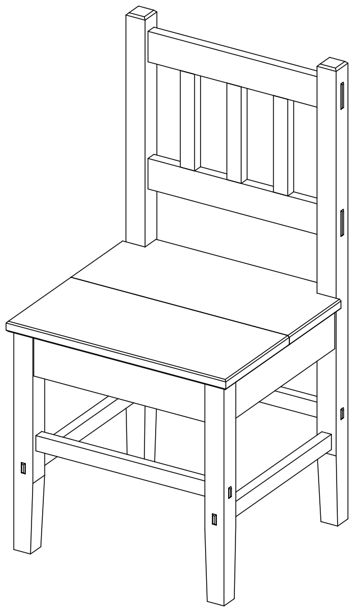
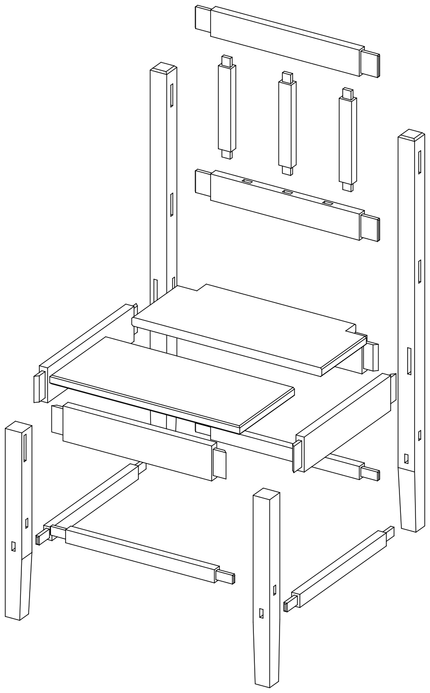

# woodwright

A semantic CAD library for woodworking. You describe furniture the way a
woodworker thinks about it: boards and rods with named sides, and the
joints between them. woodwright works out the joinery, the cut sizes and
where every part goes, and produces 3D models (STEP, STL), drawings (SVG,
PDF), the plans in one PDF and cut lists.

<div class="grid" markdown>





</div>

A chair with mortise-and-tenon joints, assembled and exploded
([projects.chair](gallery/projects/chair/index.md)). Every tenon and mortise is
derived from the joints between the parts.

```python
import woodwright as ww

oak = ww.Stock.board(thickness=20, species="oak")

frame = ww.Assembly("corner", root_location=ww.orient(right_end=ww.UP, back_edge=ww.RIGHT))
stile = frame.add(ww.Board("stile", oak, length=600, width=60))
rail = frame.add(ww.Board("rail", oak, length=300, width=60))  # shoulder to shoulder
frame.join(ww.MortiseTenon(tenon=rail.left_end, mortise=stile.back_edge))

print(frame.resolve().cut_list())
```

```text
stile  600 x 60 x 20 mm  oak
       - mortise 50 x 8 mm, 42 deep, in back_edge
rail   340 x 60 x 20 mm  oak
       - tenon 50 x 8 mm, 40 long, on left_end
```

You give the design dimensions and the joint: the tenon, the mortise, the
rail's cut length and its placement are derived.

## Where to start

<div class="grid cards" markdown>

-   **Try it without programming**

    ---

    Install it with one command, export an example and change its sizes.

    [Installation](install.md) · [Export the examples](tutorials/examples.md) ·
    [Change an example](tutorials/parameters.md)

-   **Browse the examples**

    ---

    Over 140 examples, from single cuts and joints to a table, a chair and
    a workbench, with their drawings, cut lists and plans.

    [Example gallery](gallery/index.md)

-   **Design your own**

    ---

    Start from an example's code, or describe a piece from scratch in
    Python.

    [From an example](tutorials/own-design.md) ·
    [From scratch](tutorials/from-scratch.md)

-   **Look things up**

    ---

    How a design is described, what comes out, how it works inside, and
    the API.

    [Guide](guide/concepts.md) · [Reference](reference/index.md)

</div>

woodwright is built on [build123d](https://github.com/gumyr/build123d).
This is an early alpha: the API will still change.
