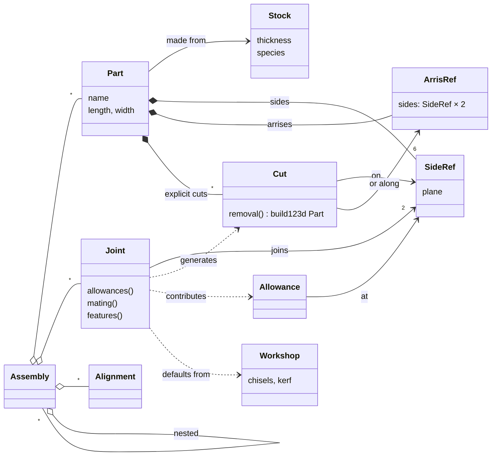
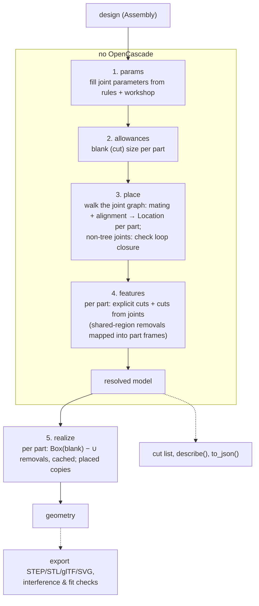

# Plan: architecture and roadmap (draft v0)

> Status: working draft. Companion to [vision.md](vision.md) (the *why*) and
> [validation.md](validation.md) (the catalogue of cuts, joints and pieces).
> This document is about the *how*: the object model, how semantic objects
> become build123d geometry, how users extend the library, and the order of
> work. Sections marked **[OPEN]** are undecided.

## 1. Principles

1. **Python library first.** Designs are Python code. No custom language
   until the object model has settled (vision §12).
2. **Semantic objects compile themselves.** There is no separate symbolic IR
   and no big central compiler. Each cut and joint knows how to produce its
   own build123d geometry, in a local frame the library hands to it. The
   "compiler" is a resolver that works out *where* and *how big*, then asks
   each object for its geometry.
3. **Open layering.** build123d types (`Location`, `Plane`, `Part`,
   `Sketch`) appear in woodwright's public API wherever geometry is
   exchanged. You drop down to build123d *inside* a semantic object (a cut,
   a joint, a custom part), never *around* it.
4. **Resolve without the kernel, realize with it.** Dimensions, allowances,
   placements and the list of features are computed without building solids.
   Cut lists and most tests don't need OpenCascade; 3D, drawings and
   interference checks do.
5. **Subtractive parts.** Part = blank − ∪ cuts, all in the part's local
   frame. Separate pieces (loose tenons, wedges, dowels) are parts in their
   own right.
6. **The design is not mutated by resolving.** `resolve()` returns a new
   resolved model. You can resolve the same design repeatedly, e.g. with a
   different workshop profile.
7. **Plain data where possible.** Stock, parts, cuts and joints are
   dataclasses with numeric/string parameters and references to sides, so a
   declarative front-end or serialization is possible later. Code is needed
   only to *define* new kinds of objects.

## 2. Object model



- **Stock**: material and cross-section. `Stock.board(thickness, species)`;
  later `Stock.rod(diameter, species)`. Knows grain direction (along L).
- **Part**: a named instance of stock with *design* dimensions. For a board:
  `length`, `width` (thickness comes from stock). The design box is what the
  user thinks of as the part's visible extent between joints, e.g. a rail
  from shoulder to shoulder.
- **SideRef**: a reference to one of the six named sides of a part
  (`rail.left_end`, `stile.back_edge`, `board.ref_face`, see vision
  §7). It gives a `Plane` in the part frame with its origin on the side's
  reference corner, x along the side's longer direction (along the grain
  where possible) and z along the side's normal. Joints mate and align parts
  by their reference sides unless told otherwise. **[OPEN]** whether the
  normal points into the material (a positive depth cuts into the wood) or
  out of it (two mating sides have opposite normals).
- **ArrisRef**: a geometric edge where two adjacent sides meet, named by
  those two sides: `board.top_right_arris`, `board.ref_arris` (=
  `top_front_arris`), or `board.arris(board.top_face, board.front_edge)` when
  the sides are only known at run time. Cuts made along an arris refer to it:
  chamfer, rabbet, later roundovers.
- **Feature (cut)**: material removed from one part. It knows its side or
  arris, its parameters, and how to build its removal volume. It also
  describes itself for cut lists and drawings: its name and key dimensions.
  It does not say *how* it is cut: the same rabbet can be made with a
  rabbet plane, a chisel or a table saw, depending on the woodworker's tools
  and choice. That belongs to the process plan, later.
- **Allowance**: an extension of a part's blank beyond its design box at one
  side, e.g. +40 mm at `rail.left_end` for a tenon. Cut dimensions = design
  dimensions + allowances.
- **Joint**: a relation between two SideRefs. It contributes allowances to
  both parts, a mating transform between them, and features on each.
  Parameters (tenon thickness...) are fields with `None` meaning "use the
  library rule".
- **Alignment**: `flush(a, b)`, `offset(a, b, d)`, `centered(...)` between
  sides of two joined parts. Joints carry their own alignment with sensible
  defaults (reference faces flush); standalone alignments are for the rare
  cases where a joint leaves freedom.
- **Assembly**: a container of parts, joints and sub-assemblies with one root
  part (or an explicit placement of the root). Components are Python
  functions/classes returning an Assembly and exposing SideRefs to join
  against.
- **Workshop**: the tools at hand. Rules of thumb round to them (a tenon
  thickness snaps to an available chisel width).

### Anchors refer to the design box, not to the blank

`rail.left_end` is the shoulder plane, the end of the design box, not the
tip of the tenon. Joints mate design sides; allowances then extend the blank
past them. Because of this, placement doesn't depend on allowances, and the
user can always measure things the way they see them in the finished piece.

The convention is uniform: a joint at an end adds whatever reaches into or
past the other part. A tenon adds the tenon length; a through dovetail or a
box joint adds the thickness of the mating board; a butt joint adds nothing.
**[OPEN]** whether users also need a "this is the overall cut length" switch
on a part. A helper that computes the design length from an outside
dimension may be enough.

## 3. The two layers

### What is semantic and what is geometric

| | Semantic (woodwright) | Geometric (build123d) |
|---|---|---|
| Where | Parameters, side references, allowances, mating, descriptions | Removal volumes, blanks, transforms |
| Needs OpenCascade | No | Yes (except `Location`/`Vector`/`Plane` maths) |
| Used for | Cut list, placement, loop checks, instructions | 3D export, drawings, interference/fit checks |

A built-in cut such as `Rabbet` is semantic *and* geometric: its parameters
(arris, width, depth) are visible to the cut list and drawings, and its
`removal()` builds a box along that arris. A user-defined cut can be
geometry-heavy and semantics-light. It still has a side, a name and a
place in the part, but its dimensions may be opaque ("cut as drawn").

### Why no kernel-neutral layer

A geometry IR independent of build123d would make every new joint harder to
write (two languages, one of them ours and always missing something) and
would buy portability we don't need (vision §14). The price is a hard
dependency on build123d/OpenCascade. We keep it contained by passing only a
few build123d types across our API (`Plane`, `Location`, `Part`, `Sketch`).

### Levels of extension

From least to most effort, each level is ordinary Python:

1. **Use** a library joint with its defaults.
2. **Override** parameters: `MortiseTenon(..., tenon_thickness=10)`.
3. **Add cuts** directly to a part:
   `part.cut(Chamfer(part.top_front_arris, 3))`.
   A chamfer runs along an arris, so it is named by the two sides that meet
   there. (A signed angle on one side would be shorter but harder to read.)
4. **Compose** a new joint from existing cuts (a bridle joint = slot mortise
   on one part, two-sided tenon on the other).
5. **Write geometry** for a new cut or joint with build123d in a provided
   frame.
6. **Custom part**: a part whose blank is an arbitrary build123d solid (a
   tapered leg), keeping a frame and named anchors. Later.

### Writing a custom cut (sketch)

```python
import math
from dataclasses import dataclass

import build123d as bd
import woodwright as ww


@dataclass
class VNotch(ww.Cut):
    """A V-shaped notch across a side, e.g. a decorative groove."""

    side: ww.SideRef
    at: float  # distance along the grain from the side's origin
    depth: float
    angle: float = 90  # included angle

    def removal(self) -> bd.Part:
        # side.plane: x along the grain, y across the side, z into the wood
        half = self.depth * math.tan(math.radians(self.angle / 2))
        # The profile is drawn in the plane spanned by the grain (x) and depth (z),
        # then extruded across the whole side (y).
        plane = self.side.plane
        profile_plane = bd.Plane(plane.origin, x_dir=plane.x_dir, z_dir=plane.y_dir)
        triangle = bd.Polygon(
            (self.at - half, 0), (self.at + half, 0), (self.at, self.depth), align=None
        )
        return bd.extrude(profile_plane * triangle, amount=self.side.width)

    def describe(self) -> str:
        return f"V-notch {self.angle}°, {self.depth} mm deep, at {self.at} mm"
```

(Sign conventions of the profile plane are glossed over here; getting such
details right once, inside SideRef helpers, is part of the library's job.)

The library places the removal in the part frame, subtracts it from the
blank, lists it in the part's drawing, and checks it doesn't break through
an unexpected side.

### Two ways a joint produces geometry

Our first two examples, written in plain build123d before the library
existed (now `joints.mortise_tenon` and `joints.dovetail_corner` in
[woodwright.examples](../src/woodwright/examples/joints.py)), show the two
patterns, and joints may use either:

1. **Per-part cuts** (mortise and tenon):
   the joint emits standard cuts on each part, each in its own part frame:
   a `Mortise` on the stile's edge and `TenonShoulders` on the rail's end.
   Most joints work this way: butt, dado, rabbet, groove, M&T, half-lap,
   bridle.
2. **Shared region** (dovetail corner):
   the joint builds the geometry once in a **joint frame** (here: the
   corner block where both boards overlap), splits it, and gives each part
   the piece it loses: the side loses `block − pins` (the tail sockets), the
   top loses `pins`. The library maps joint-frame solids into each part's
   frame through the resolved placements. Interlocking joints work this way:
   box joint, dovetails, kumiko later.

```python
@dataclass
class ThroughDovetail(ww.Joint):
    tails: ww.SideRef  # end of the tail board
    pins: ww.SideRef  # end of the pin board
    tail_count: int | None = None
    slope: float | None = None  # 1:slope

    def allowances(self, ctx):
        # both boards reach through the other one
        return [
            ww.Allowance(self.tails, self.pins.part.thickness),
            ww.Allowance(self.pins, self.tails.part.thickness),
        ]

    def mating(self, ctx) -> ww.Mating: ...  # corner: ends meet at 90°, faces flush

    def removals(self, ctx, frame: bd.Plane) -> dict[ww.Part, bd.Part]:
        block = ...  # overlap block in joint frame
        pins = ...  # trapezoidal prisms (build123d)
        return {self.pins.part: block - pins, self.tails.part: pins}
```

Because a single function builds both sides of the joint, they fit exactly
by construction. A clearance parameter can later shrink one side for a glue
gap.

## 4. Resolution ("compilation") pipeline



### Placement

Placement uses the idea behind build123d's joints (see its
[joint tutorial](https://build123d.readthedocs.io/en/latest/tutorial_joints.html)):
each side of a joint has a **mating frame**, a `Location` relative to its
part, and joining two parts means making the frames coincide. build123d's
`RigidJoint.connect_to` does this imperatively. It moves the other shape,
so the result depends on the order of calls, and it has no notion of loops.
We need the same algebra applied differently:

- Mating frames come from SideRefs and the joint's alignment (flush,
  centered, offset, which side of the part meets which), by default
  relative to the parts' reference sides.
- The resolver picks a spanning tree of the joint graph from the root part
  and composes `Location`s along it. The order in which joints were
  declared doesn't matter.
- Every joint outside the tree must agree with the placement already found.
  If it doesn't, the loop doesn't close, and the library reports by how
  much and along which part's axis, so the user can fix the dimension.
- A joint that leaves degrees of freedom open (a butt joint with no
  position along the side) is an error that names the missing alignment.
  Defaults should make this rare.
- First version: rotations are multiples of 90°, which covers orthogonal
  furniture and makes placement exact. Mitres don't need more; splayed legs
  do (later). Since then: `mate(angle=...)` / `Butt(angle=...)` turn a part
  in the plane of the side it lies on (the brace of a ledged door).

On export, the library attaches real build123d `RigidJoint`s (labelled with
the joint names) to the realized parts. Someone continuing in plain
build123d can then attach hardware or further parts to the result with
`connect_to`.

**[OPEN]** Does build123d's `Joint` class hierarchy fit our needs well
enough to subclass, rather than just reusing `Location` and attaching joints
at export? Our joints also cut and resize parts, so probably not, but we
should try it in M2.

### Defaults and rules

Rules of thumb are small named functions (`tenon_thickness(stock, workshop)
→ ⅓ T snapped to a chisel`). They are public: a user can call a rule
directly when they need a value before resolving. Overriding a rule is
passing a value. **[OPEN]** how to version rules (vision §15).

### Checks

- Kernel-free: loop closure, open degrees of freedom, cuts deeper than
  the part, allowances that make a part longer than the available stock.
- With geometry: pairwise interference between parts (bounding-box
  prefilter), joint fit (what one part loses in the joint region equals what
  the other keeps there), and volume sanity per part.
- Later: cross-grain gluing (grain directions of glued sides), assembly
  feasibility (can a part be slid in along some direction).

## 5. Package layout

As of 0.1.0:

```
src/woodwright/
  __init__.py      # public API re-exports
  stock.py         # Stock, species
  part.py          # Board, Side, SideRef, ArrisRef, part frames, mirrored boards
  placement.py     # mate, positions (flush_with, offset, centered), orient
  cuts.py          # Cut base class + library: box cuts (stoppable), tenons (multiple,
                   # wedged), tongues, dovetail tongues and laps, chamfer, mitre, taper
  joints.py        # Joint base class + library: butt, housings, mortise and tenon
                   # variants, loose tenons and tongues, laps, bridles, box joint,
                   # dovetails, mitres, button
  rules.py         # rules of thumb
  assembly.py      # Assembly, resolution, ResolvedModel, cut list
  export.py        # STEP, STL, SVG views, exploded view
  examples/        # the example library, `python -m woodwright.examples`
tests/             # unit, geometry and example tests
```

Planned as they grow: `cuts/` and `joints/` packages, `workshop.py`
(Workshop profile), `checks.py`, `output/` (drawings, cut list formats).

## 6. Roadmap

Every milestone ends with examples from [validation.md](validation.md)
running end-to-end (3D + cut list) and with tests. Milestones are ordered so
that each one tests a new piece of the architecture.

### M0: Spike (throwaway allowed) ✅ done

Re-express `mortise_tenon.py` and `dovetail_corner.py` through a minimal
prototype API (Board, SideRef, one cut per pattern, one joint per pattern),
to check §2–§4 against reality before building them properly. Output: the
same STEP/SVG as the plain versions, and notes on what felt wrong.

**Outcome.** Both examples are rewritten with woodwright. Tests confirm
the resolved geometry matches the plain build123d versions (volumes,
bounding boxes, no interference). A design now states only stock, design
dimensions and the joint; the library derives the joinery, cut lengths and
placement.

Decisions taken in the spike:

- Part frame: origin at the left end of the reference arris, x along the
  length, y towards the back edge, z up along the reference face normal.
  The design box is [0, L] × [0, W] × [−T, 0].
- Side normals point outward. Cuts into a side go to negative depth;
  tenons, cut from the allowance beyond the shoulder, go to positive depth.
- Side plane coordinates: x from the left end (faces, edges) or from the
  front edge (ends); y follows from the right-hand rule.
- The mortise is derived from the tenon: it is cut where the tenon lands,
  mapped through the placement, so the two fit by construction. This mixes
  the two patterns of §3 and may be the right default for most joints.
- Joint parameters left as `None` are filled by `with_defaults()`, which
  returns a copy; the design itself is not changed by resolving.

What felt wrong, to address before or during M1:

1. ~~Orienting the root part needs a raw build123d `Plane` with
   hand-picked axis directions. We need a readable way to say e.g. "stand
   the stile up, back edge facing right".~~ Done:
   `orient(right_end=UP, back_edge=RIGHT)` names the directions two sides
   face (`UP`, `DOWN`, `LEFT`, `RIGHT`, `FRONT` towards the viewer, `BACK`)
   and puts the design box in the positive octant from `at`.
2. ~~Offsets along an arris run in the direction given by the right-hand
   rule, so `offset(100)` on the stile counts from its *right* end.
   Offsets should be measured from a named side ("100 mm from
   `stile.left_end`").~~ Done: `offset(100, ref=stile.left_end)`,
   `flush_with(side)`.
3. The y coordinate of some side planes (`front_edge`, `right_end`, ...)
   starts at the bottom face rather than at a reference side. Predictable,
   but not what a woodworker expects. Mostly hidden by the named cuts;
   still visible in `Mortise` (backlog A6).
4. ~~`ThroughDovetail` supports only pins on a right end and tails on a left
   end. Generalizing it needs a better way to describe corners where both
   boards reach through each other.~~ Done: any ends.
5. Outside dimensions are awkward: the dovetail example computes
   `side_height - thickness` for the design length (see the open question
   in §2 about an "overall cut length" switch). Still open (backlog A4).
6. The twelve named arris properties (`top_right_arris`, ...) are not
   implemented yet, only `arris(a, b)` and `ref_arris` (backlog A5).
7. ~~The examples' SVG export triggers a build123d deprecation warning
   (0–255 RGB colours).~~ Fixed.

### M1: A single board and its cuts ✅ done

- `Stock.board`, `Board`, part frame, the six named sides and the arrises,
  with planes.
- `Cut` base class; cuts on a single board: crosscut, rip, mitre, chamfer,
  groove, dado, rabbet, end rabbet, slot mortise, tongue, mortise
  (through/blind), tenon (shoulders + cheeks).
- Realize, export, per-part SVG view, cut list entry.
- Tests: volumes and bounding boxes of each cut; cuts on every side.

Covers the "single piece" and "cuts" sections of validation.md (without
drilling).

**Outcome.** Done, pulling in most of M2–M5 and parts of M6 and M7 along
the way; drilling is left for later (rods).

- Cuts: `Groove`, `Dado`, `Rabbet`, `EndRabbet`, `SlotMortise`, `Mortise`
  are box cuts (`BoxCut`), given in woodworking terms: a width, a depth and
  a distance from a named adjacent side. The cut list names any box cut by
  its shape (a groove at the edge is listed as a rabbet). `Tenon` has
  cheeks and shoulders measured from the reference face and edge, and
  without a width spans the whole side (bridle tenon, lap); `Tongue` is a
  tenon along an edge. Tenons ask for their allowance themselves, so they
  work on a single board too. `Chamfer` (on an arris) and `Mitre` (across
  the face or the edge, the design length being the long point).
  Crosscut and rip are left out: a board is already cut to size.
- Placement: `flush_with(side)` and `offset(d, ref=side)` measure along
  the mating arris from a named side (addresses item 2 above); `across`
  centers parts of different thicknesses or sets one back.
- Joints (from M2/M3): `Butt`, and housings where part b (or a tenon on
  it) goes into a socket derived from where it lands: `DadoJoint`,
  `RabbetJoint`, `GrooveJoint`, `TongueAndGroove`, `MortiseTenon` (now with
  through tenons and offset cheeks), `Bridle`, `HalfLap` (corner and T).
- Outputs: `woodwright.export` (STEP, STL, hidden-line SVG views incl. an
  exploded one, cut list; item 7 above fixed), and
  `python -m woodwright.examples {list,export}` over the example library
  in `woodwright.examples`, whose examples are all checked for
  interference in the tests.

- Later additions: `Taper` (wedges, tapered legs; two mitres cannot make a
  wedge, as each keeps its long point at the design length), `MitreCorner`
  (picture frame, carcase), `MitreSplice`, `CrossLap`, and a `gap` in
  `mate` for overlapping parts. Practical examples in
  `woodwright.examples.projects`: try square, mallet, shooting board, butt
  box, bookshelf, dovetailed drawer, picture frame.

Lessons from the examples:

- Mirrored pairs (the left and right side of a case, the front and back of
  a box) with reference faces outside and reference edges at the front have
  their ends swapped: the right side's *left* end is at the top. Correct,
  but easy to get wrong; loop closure catches it. Done: `Board(...,
  mirror=True)` swaps the names of the ends (the frame stays right-handed),
  so a mirrored pair is described with the same names, and cuts given in
  raw coordinates (`Mortise`, `Tenon.width_offset` along an edge) are
  mirrored too. The cut list marks the part as a mirror image.
- `ThroughDovetail` now takes pins and tails on any ends (item 4): the
  tail board is placed from the named pin end, and the geometry is built
  beyond it. A classic drawer has pins at both ends of the front and back
  and tails at both ends of the sides.
- A part housed with a face (the shooting board's stop) needs `flush`
  given explicitly to lie across the other part.

- Half-blind dovetails (`HalfBlindDovetail`) are through dovetails whose
  tails stop short of the pin board's outside face; the pin board may be
  narrower than the tail board (a drawer back on its bottom). A rabbeted
  drawer bottom is a one-sided `Tongue` in a groove, listed as the rabbet
  that leaves it.
- A table top is held by buttons (`Button`): small parts screwed to the
  top, placed against an apron, with a tongue in a short mortise derived
  from it, with room to pull the top down and to let it move. A groove
  along the whole apron would weaken it. The screws are not modelled yet.
- The drawer's bottom groove runs out of the front's ends; its half pins
  are narrowed so the groove passes through the bottom tails and doesn't
  show on the side. A check that a feature runs out only where hidden
  would catch such things.

Also done since: `orient` for the root part (item 1), haunched tenons and
asymmetric shoulders, mitred tenons, a classic drawer and a dining table;
released as 0.1.0 on PyPI. What is still open is collected in the backlog
below.

### M2: Placement and one-sided joints ✅ mostly done

- `Assembly`, `Joint` base class, mating frames, alignments, the spanning
  tree resolver, errors for open degrees of freedom.
- Butt joints (edge to edge panel, face to face, face on face, edge on face),
  dado T-joint, rabbet corner, shelf with dados.
- Interference check.

**Status.** Done: assembly, joints, `mate` with positions and `across`,
the spanning-tree resolver with an error for unconnected parts, all butt
joints but face on face (bench hook), dado and rabbet joints, the
bookshelf. Open: errors for open degrees of freedom (joints place parts
fully, so there are none yet); the interference check exists only in the
tests, not as a library check (backlog D1).

### M3: Joints on both parts, allowances, defaults ✅ mostly done

- Allowances and design vs cut dimensions; rules + Workshop; overrides.
- Mortise and tenon (blind, through, extending, haunched/stub later),
  half-lap (corner, T), bridle (L, T), tongue and groove, panel in a grooved
  frame.

**Status.** Done: allowances, design vs cut dimensions, rules of thumb
with `None` defaults and explicit overrides; mortise and tenon (blind,
through, haunched, mitred, offset, asymmetric shoulders), half laps,
bridle L, tongue and groove, frame and panel. Open: the Workshop profile
(rules take e.g. chisel widths as an argument), extending and stub tenons,
bridle T (backlog B1–B3, A1).

Done on 2026-10-18 (all of backlog B):

- Mortise and tenon variants: stub, haunched and haunched stub tenons
  (`stub_tenon_corner`, `haunched_*_corner`, no grooves needed: the haunch
  mortise is a slot out of the stile's end); a through tenon standing proud
  with a chamfered end (`tenon_chamfer`); multiple tenons side by side, across
  the thickness or in a grid (`tenons`, `thickness_tenons`); mitred shoulders
  (`MitredShoulderTenon`); `WedgedMortiseTenon` (kerfs, wedges as parts, the
  mortise flared outside; modelled assembled); `TuskTenon` (a wedge through
  the protruding tenon, parallel or perpendicular to the stile).
- Separate pieces placed by a joint (`Joint.pieces`): `LooseTenon`,
  `LooseTongue`, wedges.
- `TeeBridle`, `RabbetJoint.through`, `DovetailHalfLap`, `MitredHalfLap`,
  `MitredFaceTenon`, `BoxJoint`, `MitredCornerDovetail`,
  `BlindMitredDovetail` (corner joints share a `_CornerJoint` base),
  `SlidingDovetail` across a face (battens lying flat) and with
  `cut_tongue=False` (one tongue housed in two boards).
- Stopped cuts (backlog A7): `Groove`, `Dado`, `Rabbet`, `Pocket` and the
  housing joints take `stopped={side: distance}`; the inserted part is
  notched to the stop. Not yet for sliding dovetails and mortises.
- Edge (along the grain) mitres in `Mitre` / `MitreCorner`; `Mitre` limited
  to a layer (`face`, `depth`); `Chamfer(run_out=True)` and
  `TongueAndGroove(cut_tongue=False)` for panels bevelled out to their
  edges.

### M4: Shared-region joints ✅ mostly done

- Joint frame, mapping removals into part frames, fit check.
- Box joint, through dovetail, sliding dovetail, mitre corner, splice.

**Status.** Done: geometry built once in one part's frame and mapped into
the other (`ThroughDovetail`, `HalfBlindDovetail`, `SlidingDovetail`),
mitre corners and splices, cross laps, and since 2026-10-18 the box joint
and the mitred dovetails. Open: a fit check as a library check (D2; the
tests check volumes instead).

### M5: Loops and components 🟡 in part

- Loop closure check and error messages.
- Box (four corners + bottom in a groove), picture frame (mitres or
  half-laps), drawer box.
- Components: functions returning assemblies with exposed sides; nested
  assemblies.

**Status.** Done: loop closure with an error giving the misfit, the butt
box, picture frames, frames with mortises, bridles and half laps, the
dovetailed drawer boxes. Examples are functions returning assemblies,
which is a first form of components. Open: nested assemblies and
components exposing sides to join against (A2), a box with a bottom in a
groove (C2), grouping identical parts (A3).

### M6: Outputs for the shop 🟡 in part

- Part drawings with dimensioned features, exploded views, cut list in
  CSV/Markdown, a resolved-model dump (JSON/YAML).
- First "build a real piece" attempt (e.g. a small box or a shop square)
  using only the generated outputs.

**Status.** Done: STEP and STL, hidden-line SVG views of the assembly, its
exploded view and each part, a text cut list naming every cut, the export
command line. Open: everything else above (backlog E).

### M7: Furniture 🟡 started

- Stool, side table with aprons and stretchers. Pressure-tests components,
  defaults and drawings.

**Status.** Done: a dining table (wide aprons on haunched, mitred tenons,
a glued-up top held by buttons) and a classic drawer. Open: stool, side
table, workbench (backlog C).

Done on 2026-10-18: a chair (back legs running up into the back, seat rails
as in a table, staggered stretchers and back rails on chamfered through
tenons, splats, a glued-up seat notched around the back legs, inner leg
tapers), a side table (mitred apron and stretcher tenons at one level, a
buttoned top; table, chair and side table share helpers for tops, buttons
and rails), the seat of a step stool (two boards, battens lying flat in
wide, shallow sliding dovetails), a ledged door, a ledged and braced door,
a frame-and-panel door (2x2 bevelled panels), a mitred frame with a
glued-up panel, a hollow leg, and smaller pieces (bench hook, bow saw
frame, butt and dovetail shelves, rabbeted box, shoji frame, shiplap and
loose-tongue panels, a stopped dado shelf). Open: the step stool's legs
(round, splayed: M8 and F2), the workbench.

### M8: Round stock, holes and round tenons (proposal)

Everything so far assumes a rectangular blank: `Board` has a box, six
planar sides, twelve arrises, and `ResolvedPart.shape` starts from a
`Box`. Round work adds three things: round parts, round cuts (holes) and
round tenons, which bring their own joints (dowels, pegs, wedged round
tenons).

#### Round stock

- **Names.** One stock kind, `Stock.rod(diameter, species)`, covers them
  all; the role names the part. A *dowel* is small (6–12 mm), glued into
  two holes, often fluted. A *peg* or *pin* (drawbore, pinned tenon,
  coat-rack peg) is driven into a hole, often riven and shaved, modelled
  round. A *rod*, *rung* or *pole* is larger (20–40 mm): ladder rungs, chair
  stretchers, a hanging rail. Turned legs come later as profiled rods.
- **Part.** A `Rod(name, stock, length)` next to `Board`, both subclasses of
  a common `Part` (name, stock, length, cuts, design box, sides, `blank()`).
  The rod's frame stays box-aligned, so `mate`, positions and allowances
  work unchanged: the design box is [0, L] × [0, D] × [−D, 0] with the axis
  at y = D/2, z = −D/2, and the blank is a cylinder along x. Allowances
  only go on the ends.
- **Sides.** The ends are real planar sides. The four long "sides" are
  virtual: the tangent planes of the bounding box. They are useful for
  placing a rod (flush with the top of a rail, lying on a face) and give a
  direction for cross holes. They also fix the rod's *angular reference*,
  which matters wherever a feature isn't rotationally symmetric: the kerf
  of a wedged tenon (across the grain of the mortised part), a flat, a
  cross hole. Cuts that need a planar side (groove, rabbet, dado...) refuse
  virtual sides.
- **Cut list.** "rung ø25 x 380 mm oak" instead of L x W x T; holes and
  tenons listed as usual.
- **Later.** Profiled (turned) rods as a revolved outline along the
  length: tapers, beads, shoulders. Square stock turned round in part
  (a leg square at the aprons, round below) is a board with a revolved cut.

#### Round cuts (holes)

- `Hole(side, diameter, depth=None, at=...)`: a cylinder into a side along
  its normal; `depth=None` goes through. Positioned on the side by two
  distances from named sides (a new `at(...)`-style position with two
  offsets, or centered). Flat bottom by default (Forstner, auger with the
  spur ignored); a conical drill point is a cosmetic option.
- `Counterbore` (a wider, shallow cylinder over a hole, for a screw head or
  a plug) and `Countersink` (a cone, 82°/90°), as options of `Hole` or as
  their own cuts. Pocket holes later (angled).
- `TaperedHole(diameter, angle or diameter at the bottom)`: reamed holes for
  tapered round tenons (Windsor chairs), and the flared end of a hole for a
  wedged round tenon.
- Holes into a rod: from a virtual side (a cross hole, e.g. a drawbore peg
  through a round tenon) or into an end (a dowel into a rod's end).
- Related round features on boards, not holes but needing round geometry:
  round-ended mortises (router, loose tenon / Domino style), rounded ends of
  stopped grooves, roundovers on arrises.
- Geometry with build123d `Cylinder`/`Cone` placed on the side's plane;
  the cut list names them ("hole ø8, 30 deep, in leg.top_face, 20 from
  leg.left_end, centered"). A Workshop profile (A1) snaps diameters to the
  drill bits at hand.

#### Round tenons

- `RoundTenon(side, diameter, length, shoulder...)` on an end: on a rod (a
  turned or tenon-cutter shoulder) or on square stock (a square leg with a
  round tenon). Options: tapered (Windsor), a kerf for a wedge, a chamfered
  end. As with `Tenon`, it asks for its allowance itself.
- `RoundMortiseTenon(tenon, mortise=side)`: like `MortiseTenon`, the hole
  is derived from where the tenon lands, so they fit by construction;
  blind or through. `WedgedRoundTenon`: a through tenon with a kerf
  oriented across the grain of the mortised part (so the wedge doesn't split
  it) and a wedge as a separate piece, the hole optionally flared.
- A whole rod in a hole (rungs into stiles, a rail into posts) is the same
  joint with the rod's whole cross-section going in.

#### New joints on top of these

- `Dowels(a, b, count, diameter, length)`: holes in both parts and dowels as
  pieces (`Joint.pieces`, like `LooseTenon`), for edge joints, carcase
  corners and frame corners (a dowelled butt joint).
- `Peg` / pinned and drawbored mortise and tenon: a hole through the
  mortise's cheeks and the tenon, a peg as a piece. The drawbore offset (the
  hole in the tenon 1–2 mm towards the shoulder) is recorded for the cut
  list, while the geometry shows the assembled state with straight holes, as
  for the wedged tenons.
- Screws as annotated holes (A8): a pilot hole, a clearance hole and a
  countersink or counterbore (buttons, battens, ledged doors). The screw
  itself as hardware later.

#### Which existing joints work with round stock

| | Rod as the inserted part (its end) | Rod as the receiving part |
|---|---|---|
| Hole, round tenon, dowel, peg, wedged round tenon | ✅ the natural joints | ✅ (cross holes; the rod must be thick enough) |
| `Butt` | ✅ end on a face (glued only for show; usually with a dowel or screw) | ⚠️ line contact only; refuse or require a flat |
| `MortiseTenon` with a rectangular tenon | ⚠️ possible (a rod end cut square), rare; refuse at first | ⚠️ a mortise into a rod (Windsor, ladders with square rungs), later |
| Housings (dado, groove, rabbet), laps, bridles, dovetails, box joint, mitres, tongues | ❌ need planar sides | ❌ |
| `Mitre`, `Taper`, `Chamfer` as cuts on a rod | end mitre ✅ (with the angular reference); taper → conical; end chamfer → cone | — |

Joints check the kind of the parts they join and fail early with a clear
message ("a dado needs a board, rung is a rod"), rather than producing odd
geometry. Box cuts still work geometrically on a rod (a flat, a notch, a
half lap on a pole), so they can stay allowed where it makes sense, named
as flats or notches in the cut list.

#### Steps

1. `Part` base class with `Board` and `Rod`; `blank()` per kind (box or
   cylinder); `Stock.rod`; the cut list per kind. All existing joints and
   cuts type-checked to boards. No geometry change for boards (the examples'
   outputs stay byte-identical).
2. `Hole` (through, blind), counterbore, countersink, tapered hole, the
   two-offset position on a side. Tests: volumes (πr²h within the
   tessellation tolerance), positions, holes in rods.
3. `RoundTenon` and `RoundMortiseTenon` (rod and square stock), whole rods
   in holes, then the wedged round tenon.
4. `Dowels`, pegs and drawbores, screw holes.
5. Examples: a dowelled edge joint and frame corner, a pinned and a
   drawbored mortise and tenon, a ladder or towel rail (rungs in holes in
   square stiles), a coat rack with pegs, a stool with round legs wedged
   through the seat (straight first; splayed with F2), the step stool's legs
   through the seat and the battens, shelf-pin holes, the buttons' screw
   holes.
6. Later: turned (profiled) rods, tapered tenons and reamed holes for
   Windsor work, angled holes (F2), round-ended mortises, roundovers.

**[OPEN]**

- Rod frame: box-aligned (proposed, everything else keeps working) or the
  axis on x at the origin (cleaner for revolved profiles).
- Whether virtual sides are `SideRef`s with a flag, or a separate type that
  only placement and holes accept.
- Fits: holes as large as the dowel (touching, as now for all joints) and
  clearance or interference (pegs, drawbores) as a parameter that only
  changes the cut list, or real clearance in the geometry. The interference
  check needs a tolerance either way, since cylinders are tessellated for
  STL and SVG and volumes are approximate.
- Hidden-line SVG views of cylinders (silhouette edges) need a check.

### Next steps: backlog (to be prioritized)

IDs are for reference when prioritizing. Joints and examples come from
[validation.md](validation.md), where they are also listed.

**A. Library and API**

- A1. Workshop profile: available tools (chisels, router bits, saw kerf)
  that the rules snap to, passed to `resolve()`.
- A2. Components: nested assemblies, and functions returning assemblies
  that expose sides to join against (a drawer joined into a carcase).
- A3. Identical parts: group them in the cut list ("4 x leg"), name them
  in components (four legs, ten buttons).
- A4. Outside dimensions: a helper or a switch for parts given by their
  overall length (dovetailed boards, drawers).
- A5. The twelve named arrises (`top_right_arris`, ...).
- A6. Side-plane coordinates measured from reference sides (M0 item 3).
- A7. ✅ Stopped grooves, dados and rabbets. Open: stopped sliding
  dovetails and mortises.
- A8. Screws and other fasteners as parts or annotations (buttons, the
  drawer bottom's slot screw).

**B. Joints on the existing machinery** ✅ all done on 2026-10-18 (see M3)

- B1. ✅ Stub tenon, haunched stub tenon.
- B2. ✅ Tenon extending out of a through mortise (chamfered end).
- B3. ✅ Bridle T-joint.
- B4. ✅ Box joint.
- B5. ✅ Multiple tenons (side by side, across the thickness, grids).
- B6. ✅ Loose tenon.
- B7. ✅ Loose tongue (grain along the joint only).
- B8. ✅ Mitred and dovetailed half laps.
- B9. ✅ Mitred-shoulder tenons (L and T), mitred face tenon. The
  bridle-like Japanese sword-hilt forms are still open.
- B10. ✅ Dovetail with mitred corners; blind mitred dovetail.
- B11. ✅ Wedged through tenon.
- B12. ✅ Tusk tenon, both wedge orientations.
- B13. ✅ Shiplap panel.
- B14. ✅ Tapered panel edges (drawer bottom, door panels).

**C. Examples and projects**

- C1. ✅ Bench hook, shelf with only butt joints.
- C2. ✅ Box with rabbeted corners and a rabbeted bottom.
- C3. ✅ Frame and panel with a butt-jointed frame and a tongued panel.
- C4. ✅ Bow saw frame, shoji frame.
- C5. ✅ Shelf with dovetailed corners.
- C6. ✅ Hollow leg of four edge-mitred boards.
- C7. ✅ Mitred frame with an inset panel of glued-up boards.
- C8. ✅ Side table with aprons and stretchers (with a glued-up top; the
  mitre-frame top was dropped).
- C9. Workbench: leg assemblies, glued-up beams, half laps, tusk-tenoned
  stretchers, a top of laminated beams, a drawer.
- C10. Step stool: ✅ the seat with sliding dovetail battens; open: splayed
  legs with wedged round tenons (needs M8 and F2).
- C11. ✅ Chair, doors (ledged, ledged and braced, frame and panel).

**D. Checks**

- D1. Interference as a library check (`model.check()`), not only in tests.
- D2. Joint fit: what one part loses in a joint region equals what the
  other keeps there.
- D3. Features running out of a part where they show (the drawer groove
  through a half pin).
- D4. Kernel-free checks: cuts deeper than the part, parts longer than the
  stock, cross-grain gluing.

**E. Outputs**

- E1. Part drawings with dimensioned features.
- E2. Cut list as CSV and Markdown; a resolved-model dump (JSON/YAML).
- E3. Cut list snapshots of the examples in the tests.
- E4. Documentation: a user guide, rendered examples (e.g. on GitHub
  Pages).
- E5. First "build a real piece" attempt from the generated outputs only.

**F. New kinds of geometry** (see Later)

- F1. Rods and drilling: dowels, holes (through, blind, countersunk),
  round tenons, drawbores. Planned as M8 below.
- F2. Angled parts and joints: splayed legs, angled half laps.
- F3. Joints of more than two parts: kumiko, three-way mitres.

**G. Project infrastructure**

- G1. CI on GitHub Actions: tests and lint on every push.
- G2. Releases to PyPI from a tag with trusted publishing.
- G3. A changelog.

### Later

- Rods and drilling: see M8.
- Angled parts and joints: splayed legs, angled half-laps, compound angles.
- Joints of more than two parts (kumiko, three-way mitres).
- Process plan: operations per part, order, glue-up sequence, instructions.
- Stock layout, shopping list.
- Declarative front-end.

## 7. Testing strategy

- **Kernel-free unit tests** for resolution: allowances, cut dimensions,
  placements (compare `Location`s), loop closure, error messages.
- **Geometry tests** on small parts: volume of a part = blank − expected
  removed volume; zero interference in assembled joints; joint fit.
- **Example tests**: every example in `woodwright.examples` resolves
  without interference between its parts; later, its cut list matches a
  stored snapshot (backlog E3).
- Visual outputs (SVG) are checked by eye at first. Snapshot tests for them
  only if they turn out stable.

## 8. Open questions (implementation)

- Do parts and joints register into an assembly explicitly
  (`frame.add`, `frame.join`), or are they discovered from the joint graph?
  Explicit looks better for composability (no global state). We'll check
  with M2.
- Builder-style context managers (like build123d's `BuildPart`) or plain
  object construction? Start with plain objects; consider builders if
  designs read badly.
- Identity of parts: how components produce several parts with the same
  name (four legs), and how the cut list groups identical parts.
- Where clearances live (joint parameter, workshop default, or both).
