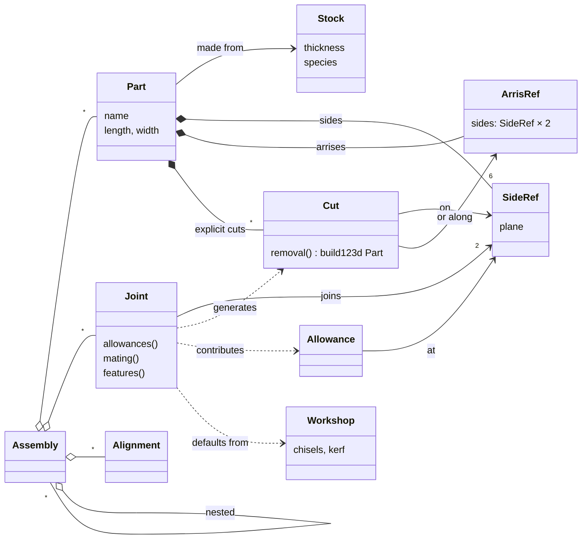
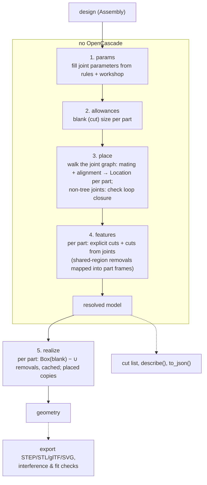

# Plan: architecture and roadmap (draft v0)

> Status: working draft. Companion to [vision.md](vision.md) (the *why*) and
> [validation.md](validation.md) (the catalogue of cuts, joints and pieces).
> This document is about the *how*: the object model, how semantic objects
> become build123d geometry, how users extend the library, and the order of
> work. Sections marked **[OPEN]** are undecided.

## 1. Principles

1. **Python library first.** Designs are Python code. No custom language
   until the object model has settled (vision §12).
2. **Semantic objects compile themselves.** There is no separate symbolic IR
   and no big central compiler. Each cut and joint knows how to produce its
   own build123d geometry, in a local frame the library hands to it. The
   "compiler" is a resolver that works out *where* and *how big*, then asks
   each object for its geometry.
3. **Open layering.** build123d types (`Location`, `Plane`, `Part`,
   `Sketch`) appear in woodwright's public API wherever geometry is
   exchanged. You drop down to build123d *inside* a semantic object (a cut,
   a joint, a custom part), never *around* it.
4. **Resolve without the kernel, realize with it.** Dimensions, allowances,
   placements and the list of features are computed without building solids.
   Cut lists and most tests don't need OpenCascade; 3D, drawings and
   interference checks do.
5. **Subtractive parts.** Part = blank − ∪ cuts, all in the part's local
   frame. Separate pieces (loose tenons, wedges, dowels) are parts in their
   own right.
6. **The design is not mutated by resolving.** `resolve()` returns a new
   resolved model. You can resolve the same design repeatedly, e.g. with a
   different workshop profile.
7. **Plain data where possible.** Stock, parts, cuts and joints are
   dataclasses with numeric/string parameters and references to sides, so a
   declarative front-end or serialization is possible later. Code is needed
   only to *define* new kinds of objects.

## 2. Object model



- **Stock**: material and cross-section. `Stock.board(thickness, species)`;
  later `Stock.rod(diameter, species)`. Knows grain direction (along L).
- **Part**: a named instance of stock with *design* dimensions. For a board:
  `length`, `width` (thickness comes from stock). The design box is what the
  user thinks of as the part's visible extent between joints, e.g. a rail
  from shoulder to shoulder.
- **SideRef**: a reference to one of the six named sides of a part
  (`rail.left_end`, `stile.back_edge`, `board.ref_face`, see vision
  §7). It gives a `Plane` in the part frame with its origin on the side's
  reference corner, x along the side's longer direction (along the grain
  where possible) and z along the side's normal. Joints mate and align parts
  by their reference sides unless told otherwise. **[OPEN]** whether the
  normal points into the material (a positive depth cuts into the wood) or
  out of it (two mating sides have opposite normals).
- **ArrisRef**: a geometric edge where two adjacent sides meet, named by
  those two sides: `board.top_right_arris`, `board.ref_arris` (=
  `top_front_arris`), or `board.arris(board.top_face, board.front_edge)` when
  the sides are only known at run time. Cuts made along an arris refer to it:
  chamfer, rabbet, later roundovers.
- **Feature (cut)**: material removed from one part. It knows its side or
  arris, its parameters, and how to build its removal volume. It also
  describes itself for cut lists and drawings: its name and key dimensions.
  It does not say *how* it is cut: the same rabbet can be made with a
  rabbet plane, a chisel or a table saw, depending on the woodworker's tools
  and choice. That belongs to the process plan, later.
- **Allowance**: an extension of a part's blank beyond its design box at one
  side, e.g. +40 mm at `rail.left_end` for a tenon. Cut dimensions = design
  dimensions + allowances.
- **Joint**: a relation between two SideRefs. It contributes allowances to
  both parts, a mating transform between them, and features on each.
  Parameters (tenon thickness...) are fields with `None` meaning "use the
  library rule".
- **Alignment**: `flush(a, b)`, `offset(a, b, d)`, `centered(...)` between
  sides of two joined parts. Joints carry their own alignment with sensible
  defaults (reference faces flush); standalone alignments are for the rare
  cases where a joint leaves freedom.
- **Assembly**: a container of parts, joints and sub-assemblies with one root
  part (or an explicit placement of the root). Components are Python
  functions/classes returning an Assembly and exposing SideRefs to join
  against.
- **Workshop**: the tools at hand. Rules of thumb round to them (a tenon
  thickness snaps to an available chisel width).

### Anchors refer to the design box, not to the blank

`rail.left_end` is the shoulder plane, the end of the design box, not the
tip of the tenon. Joints mate design sides; allowances then extend the blank
past them. Because of this, placement doesn't depend on allowances, and the
user can always measure things the way they see them in the finished piece.

The convention is uniform: a joint at an end adds whatever reaches into or
past the other part. A tenon adds the tenon length; a through dovetail or a
box joint adds the thickness of the mating board; a butt joint adds nothing.
**[OPEN]** whether users also need a "this is the overall cut length" switch
on a part. A helper that computes the design length from an outside
dimension may be enough.

## 3. The two layers

### What is semantic and what is geometric

| | Semantic (woodwright) | Geometric (build123d) |
|---|---|---|
| Where | Parameters, side references, allowances, mating, descriptions | Removal volumes, blanks, transforms |
| Needs OpenCascade | No | Yes (except `Location`/`Vector`/`Plane` maths) |
| Used for | Cut list, placement, loop checks, instructions | 3D export, drawings, interference/fit checks |

A built-in cut such as `Rabbet` is semantic *and* geometric: its parameters
(arris, width, depth) are visible to the cut list and drawings, and its
`removal()` builds a box along that arris. A user-defined cut can be
geometry-heavy and semantics-light. It still has a side, a name and a
place in the part, but its dimensions may be opaque ("cut as drawn").

### Why no kernel-neutral layer

A geometry IR independent of build123d would make every new joint harder to
write (two languages, one of them ours and always missing something) and
would buy portability we don't need (vision §14). The price is a hard
dependency on build123d/OpenCascade. We keep it contained by passing only a
few build123d types across our API (`Plane`, `Location`, `Part`, `Sketch`).

### Levels of extension

From least to most effort, each level is ordinary Python:

1. **Use** a library joint with its defaults.
2. **Override** parameters: `MortiseTenon(..., tenon_thickness=10)`.
3. **Add cuts** directly to a part:
   `part.cut(Chamfer(part.top_front_arris, 3))`.
   A chamfer runs along an arris, so it is named by the two sides that meet
   there. (A signed angle on one side would be shorter but harder to read.)
4. **Compose** a new joint from existing cuts (a bridle joint = slot mortise
   on one part, two-sided tenon on the other).
5. **Write geometry** for a new cut or joint with build123d in a provided
   frame.
6. **Custom part**: a part whose blank is an arbitrary build123d solid (a
   tapered leg), keeping a frame and named anchors. Later.

### Writing a custom cut (sketch)

```python
import math
from dataclasses import dataclass

import build123d as bd
import woodwright as ww


@dataclass
class VNotch(ww.Cut):
    """A V-shaped notch across a side, e.g. a decorative groove."""

    side: ww.SideRef
    at: float  # distance along the grain from the side's origin
    depth: float
    angle: float = 90  # included angle

    def removal(self) -> bd.Part:
        # side.plane: x along the grain, y across the side, z into the wood
        half = self.depth * math.tan(math.radians(self.angle / 2))
        # The profile is drawn in the plane spanned by the grain (x) and depth (z),
        # then extruded across the whole side (y).
        plane = self.side.plane
        profile_plane = bd.Plane(plane.origin, x_dir=plane.x_dir, z_dir=plane.y_dir)
        triangle = bd.Polygon(
            (self.at - half, 0), (self.at + half, 0), (self.at, self.depth), align=None
        )
        return bd.extrude(profile_plane * triangle, amount=self.side.width)

    def describe(self) -> str:
        return f"V-notch {self.angle}°, {self.depth} mm deep, at {self.at} mm"
```

(Sign conventions of the profile plane are glossed over here; getting such
details right once, inside SideRef helpers, is part of the library's job.)

The library places the removal in the part frame, subtracts it from the
blank, lists it in the part's drawing, and checks it doesn't break through
an unexpected side.

### Two ways a joint produces geometry

Our two plain-build123d examples show the two patterns, and joints may use
either:

1. **Per-part cuts** ([mortise_tenon.py](../examples/mortise_tenon.py)):
   the joint emits standard cuts on each part, each in its own part frame:
   a `Mortise` on the stile's edge and `TenonShoulders` on the rail's end.
   Most joints work this way: butt, dado, rabbet, groove, M&T, half-lap,
   bridle.
2. **Shared region** ([dovetail_corner.py](../examples/dovetail_corner.py)):
   the joint builds the geometry once in a **joint frame** (here: the
   corner block where both boards overlap), splits it, and gives each part
   the piece it loses: the side loses `block − pins` (the tail sockets), the
   top loses `pins`. The library maps joint-frame solids into each part's
   frame through the resolved placements. Interlocking joints work this way:
   box joint, dovetails, kumiko later.

```python
@dataclass
class ThroughDovetail(ww.Joint):
    tails: ww.SideRef  # end of the tail board
    pins: ww.SideRef  # end of the pin board
    tail_count: int | None = None
    slope: float | None = None  # 1:slope

    def allowances(self, ctx):
        # both boards reach through the other one
        return [
            ww.Allowance(self.tails, self.pins.part.thickness),
            ww.Allowance(self.pins, self.tails.part.thickness),
        ]

    def mating(self, ctx) -> ww.Mating: ...  # corner: ends meet at 90°, faces flush

    def removals(self, ctx, frame: bd.Plane) -> dict[ww.Part, bd.Part]:
        block = ...  # overlap block in joint frame
        pins = ...  # trapezoidal prisms (build123d)
        return {self.pins.part: block - pins, self.tails.part: pins}
```

Because a single function builds both sides of the joint, they fit exactly
by construction. A clearance parameter can later shrink one side for a glue
gap.

## 4. Resolution ("compilation") pipeline



### Placement

Placement uses the idea behind build123d's joints (see its
[joint tutorial](https://build123d.readthedocs.io/en/latest/tutorial_joints.html)):
each side of a joint has a **mating frame**, a `Location` relative to its
part, and joining two parts means making the frames coincide. build123d's
`RigidJoint.connect_to` does this imperatively. It moves the other shape,
so the result depends on the order of calls, and it has no notion of loops.
We need the same algebra applied differently:

- Mating frames come from SideRefs and the joint's alignment (flush,
  centered, offset, which side of the part meets which), by default
  relative to the parts' reference sides.
- The resolver picks a spanning tree of the joint graph from the root part
  and composes `Location`s along it. The order in which joints were
  declared doesn't matter.
- Every joint outside the tree must agree with the placement already found.
  If it doesn't, the loop doesn't close, and the library reports by how
  much and along which part's axis, so the user can fix the dimension.
- A joint that leaves degrees of freedom open (a butt joint with no
  position along the side) is an error that names the missing alignment.
  Defaults should make this rare.
- First version: rotations are multiples of 90°, which covers orthogonal
  furniture and makes placement exact. Mitres don't need more; splayed legs
  do (later).

On export, the library attaches real build123d `RigidJoint`s (labelled with
the joint names) to the realized parts. Someone continuing in plain
build123d can then attach hardware or further parts to the result with
`connect_to`.

**[OPEN]** Does build123d's `Joint` class hierarchy fit our needs well
enough to subclass, rather than just reusing `Location` and attaching joints
at export? Our joints also cut and resize parts, so probably not, but we
should try it in M2.

### Defaults and rules

Rules of thumb are small named functions (`tenon_thickness(stock, workshop)
→ ⅓ T snapped to a chisel`). They are public: a user can call a rule
directly when they need a value before resolving. Overriding a rule is
passing a value. **[OPEN]** how to version rules (vision §15).

### Checks

- Kernel-free: loop closure, open degrees of freedom, cuts deeper than
  the part, allowances that make a part longer than the available stock.
- With geometry: pairwise interference between parts (bounding-box
  prefilter), joint fit (what one part loses in the joint region equals what
  the other keeps there), and volume sanity per part.
- Later: cross-grain gluing (grain directions of glued sides), assembly
  feasibility (can a part be slid in along some direction).

## 5. Package layout (proposed)

```
src/woodwright/
  __init__.py      # public API re-exports
  stock.py         # Stock, species
  part.py          # Part, Board (Rod later), SideRef, ArrisRef, part frames
  cuts/            # Cut base class + library: planar, rabbet, dado, groove, mortise, tenon, ...
  joints/          # Joint base class + library: butt, dado, rabbet, mt, lap, bridle, dovetail, ...
  rules.py         # rules of thumb
  workshop.py      # Workshop profile
  assembly.py      # Assembly, Alignment
  resolve.py       # pipeline steps 1–4, ResolvedModel
  realize.py       # step 5: build123d geometry
  checks.py
  output/          # cut list, export, drawings
tests/             # mostly kernel-free; geometry tests use small parts
examples/          # one per validation step, writing to output/
```

## 6. Roadmap

Every milestone ends with examples from [validation.md](validation.md)
running end-to-end (3D + cut list) and with tests. Milestones are ordered so
that each one tests a new piece of the architecture.

### M0: Spike (throwaway allowed) ✅ done

Re-express `mortise_tenon.py` and `dovetail_corner.py` through a minimal
prototype API (Board, SideRef, one cut per pattern, one joint per pattern),
to check §2–§4 against reality before building them properly. Output: the
same STEP/SVG as the plain versions, and notes on what felt wrong.

**Outcome.** Both examples are rewritten with woodwright. Tests confirm
the resolved geometry matches the plain build123d versions (volumes,
bounding boxes, no interference). A design now states only stock, design
dimensions and the joint; the library derives the joinery, cut lengths and
placement.

Decisions taken in the spike:

- Part frame: origin at the left end of the reference arris, x along the
  length, y towards the back edge, z up along the reference face normal.
  The design box is [0, L] × [0, W] × [−T, 0].
- Side normals point outward. Cuts into a side go to negative depth;
  tenons, cut from the allowance beyond the shoulder, go to positive depth.
- Side plane coordinates: x from the left end (faces, edges) or from the
  front edge (ends); y follows from the right-hand rule.
- The mortise is derived from the tenon: it is cut where the tenon lands,
  mapped through the placement, so the two fit by construction. This mixes
  the two patterns of §3 and may be the right default for most joints.
- Joint parameters left as `None` are filled by `with_defaults()`, which
  returns a copy; the design itself is not changed by resolving.

What felt wrong, to address before or during M1:

1. Orienting the root part needs a raw build123d `Plane` with
   hand-picked axis directions. We need a readable way to say e.g. "stand
   the stile up, back edge facing right".
2. Offsets along an arris run in the direction given by the right-hand
   rule, so `offset(100)` on the stile counts from its *right* end.
   Offsets should be measured from a named side ("100 mm from
   `stile.left_end`").
3. The y coordinate of some side planes (`front_edge`, `right_end`, ...)
   starts at the bottom face rather than at a reference side. Predictable,
   but not what a woodworker expects.
4. `ThroughDovetail` supports only pins on a right end and tails on a left
   end. Generalizing it needs a better way to describe corners where both
   boards reach through each other.
5. Outside dimensions are awkward: the dovetail example computes
   `side_height - thickness` for the design length (see the open question
   in §2 about an "overall cut length" switch).
6. The twelve named arris properties (`top_right_arris`, ...) are not
   implemented yet, only `arris(a, b)` and `ref_arris`.
7. The examples' SVG export triggers a build123d deprecation warning
   (0–255 RGB colours).

### M1: A single board and its cuts

- `Stock.board`, `Board`, part frame, the six named sides and the arrises,
  with planes.
- `Cut` base class; cuts on a single board: crosscut, rip, mitre, chamfer,
  groove, dado, rabbet, end rabbet, slot mortise, tongue, mortise
  (through/blind), tenon (shoulders + cheeks).
- Realize, export, per-part SVG view, cut list entry.
- Tests: volumes and bounding boxes of each cut; cuts on every side.

Covers the "single piece" and "cuts" sections of validation.md (without
drilling).

### M2: Placement and one-sided joints

- `Assembly`, `Joint` base class, mating frames, alignments, the spanning
  tree resolver, errors for open degrees of freedom.
- Butt joints (edge to edge panel, face to face, face on face, edge on face),
  dado T-joint, rabbet corner, shelf with dados.
- Interference check.

### M3: Joints on both parts, allowances, defaults

- Allowances and design vs cut dimensions; rules + Workshop; overrides.
- Mortise and tenon (blind, through, extending, haunched/stub later),
  half-lap (corner, T), bridle (L, T), tongue and groove, panel in a grooved
  frame.

### M4: Shared-region joints

- Joint frame, mapping removals into part frames, fit check.
- Box joint, through dovetail, sliding dovetail, mitre corner, splice.

### M5: Loops and components

- Loop closure check and error messages.
- Box (four corners + bottom in a groove), picture frame (mitres or
  half-laps), drawer box.
- Components: functions returning assemblies with exposed sides; nested
  assemblies.

### M6: Outputs for the shop

- Part drawings with dimensioned features, exploded views, cut list in
  CSV/Markdown, a resolved-model dump (JSON/YAML).
- First "build a real piece" attempt (e.g. a small box or a shop square)
  using only the generated outputs.

### M7: Furniture

- Stool, side table with aprons and stretchers. Pressure-tests components,
  defaults and drawings.

### Later

- Rods and drilling: dowel joints, round tenons, drawbores, wedged and tusk
  tenons.
- Angled parts and joints: splayed legs, angled half-laps, compound angles.
- Joints of more than two parts (kumiko, three-way mitres).
- Process plan: operations per part, order, glue-up sequence, instructions.
- Stock layout, shopping list.
- Declarative front-end.

## 7. Testing strategy

- **Kernel-free unit tests** for resolution: allowances, cut dimensions,
  placements (compare `Location`s), loop closure, error messages.
- **Geometry tests** on small parts: volume of a part = blank − expected
  removed volume; zero interference in assembled joints; joint fit.
- **Example tests**: every example in `examples/` runs (smoke test), and
  its cut list matches a stored snapshot.
- Visual outputs (SVG) are checked by eye at first. Snapshot tests for them
  only if they turn out stable.

## 8. Open questions (implementation)

- Do parts and joints register into an assembly explicitly
  (`frame.add`, `frame.join`), or are they discovered from the joint graph?
  Explicit looks better for composability (no global state). We'll check
  with M2.
- Builder-style context managers (like build123d's `BuildPart`) or plain
  object construction? Start with plain objects; consider builders if
  designs read badly.
- Identity of parts: how components produce several parts with the same
  name (four legs), and how the cut list groups identical parts.
- Where clearances live (joint parameter, workshop default, or both).
